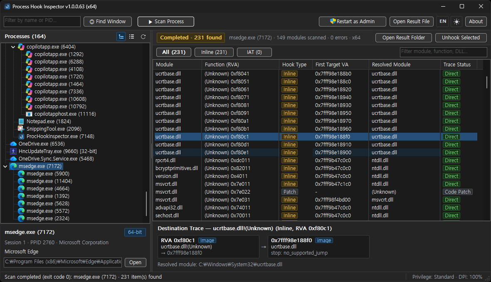

# Process Hook Inspector

실행 중인 프로세스의 **인라인 후킹·IAT 후킹·코드 변경**을 찾아 보여 주는 도구입니다.
검사 엔진으로 [PE-sieve](https://github.com/hasherezade/pe-sieve)를 내장하고 있으며, 후킹된 함수가 어디로 분기하는지(목적지 모듈)도 함께 추적합니다.

[English](#english)



**Lite 버전**(`ProcHookInspectorLite.exe`)은 **언훅 기능이 빠진 검사 전용 버전**입니다.

## 다운로드

[Releases](../../releases/latest)에서 `ProcHookInspectorLite_vX.Y.Z.W.zip`을 내려받아 **쓰기 가능한 폴더에 압축을 푼 뒤** 실행합니다.

- 설치가 필요 없습니다. 실행 파일 하나로 동작합니다.
- 검사 결과는 실행 파일 옆 `ScanResults` 폴더에, 창 설정은 `ProcHookInspectorLite.ini`에 저장됩니다.

## 실행 환경

- Windows 10 / 11 (64비트)
- 32비트 프로세스도 검사할 수 있습니다.
- 다른 사용자·서비스 프로세스를 검사하려면 **관리자 권한**이 필요합니다. 상단 `관리자 권한으로 재시작` 버튼으로 전환할 수 있습니다.

## 사용법

1. `ProcHookInspectorLite.exe`를 실행합니다.
2. 왼쪽 프로세스 목록에서 대상을 고르거나 `윈도우로 찾기`를 창 위로 끌어다 놓아 선택합니다.
3. `선택 프로세스 검사`를 누르면 후킹 목록이 오른쪽에 표시됩니다.
4. 항목을 선택하면 아래 `분기 추적 상세`에 분기 경로와 목적지 모듈이 표시됩니다.

- `결과 파일 열기`로 저장된 `ScanResult.json`을 다시 열어 볼 수 있습니다(드래그 앤 드롭 가능).
- 상단 `KO`/`EN` 버튼으로 한국어·영어를, 해/달 버튼으로 라이트·다크 테마를 바꿀 수 있습니다.

## 결과 보기

| 열 | 의미 |
|---|---|
| 후킹 종류 | `인라인` 함수 앞부분 분기 · `IAT` 임포트 주소 변경 · `패치` 그 밖의 코드 변경 |
| 첫 목적지 주소 | 후킹 코드가 처음 분기하는 주소 |
| 최종 연결 모듈 | 분기를 따라가 도착한 목적지가 속한 모듈 |
| 추적 상태 | `직접 연결` 목적지 확인 · `코드 패치` 분기가 아닌 코드 변경 등 추적 결과 |

## 명령줄

결과를 표준 출력에 JSON으로 씁니다. GUI 실행 파일이므로 PowerShell에서는 `| Out-String`이나 `> out.json`으로 받아야 종료 코드와 출력이 정확히 전달됩니다.

```
ProcHookInspectorLite.exe scan --pid <PID> [--timeout <초>] [--out <폴더>]   검사
ProcHookInspectorLite.exe parse <파일>                                       저장된 결과(execution.json 등) 다시 읽기
ProcHookInspectorLite.exe --help                                             도움말
```

```powershell
.\ProcHookInspectorLite.exe scan --pid 1234 | Out-String
```

종료 코드: `0` 검사 완료 · `1` 검사 실패 · `2` 부분 검사 · `3` 인자 오류(Lite 버전의 `unhook` 포함).
`0`은 후킹이 없다는 뜻이 아니며, 탐지 건수는 출력 JSON의 `findings_reported`로 확인합니다.

## 주의

- 다른 프로세스의 메모리를 읽기 때문에 일부 백신·EDR 제품이 경고하거나 막을 수 있습니다.

## 라이선스

개인·기업·기관 누구나 **무료로 사용**할 수 있습니다. 단, **재배포는 허용하지 않습니다.**
다른 사람과 공유할 때는 이 페이지의 링크를 알려 주십시오. 수정, 역설계, 판매는 금지되며 무보증으로 제공됩니다.
자세한 조건은 [LICENSE](LICENSE)를 참고하십시오.

포함된 오픈소스 구성요소 [PE-sieve](https://github.com/hasherezade/pe-sieve)·[libpeconv](https://github.com/hasherezade/libpeconv)·[sig_finder](https://github.com/hasherezade/sig_finder)는
각자의 BSD-2-Clause 라이선스를 따르며, 원문은 프로그램의 `정보` 창에서 볼 수 있습니다.

---

<a id="english"></a>

## English

A tool that finds and shows **inline hooks, IAT hooks and code modifications** in running processes.
It embeds [PE-sieve](https://github.com/hasherezade/pe-sieve) as its scan engine and also traces where each hooked function jumps to (the destination module).
The user interface supports Korean and English.

The **Lite edition** (`ProcHookInspectorLite.exe`) is a **scan-only edition without the Unhook feature**.

### Download

Download `ProcHookInspectorLite_vX.Y.Z.W.zip` from [Releases](../../releases/latest), **extract it to a writable folder** and run it from there.

- No installation is needed. It is a single executable.
- Scan results are saved to the `ScanResults` folder next to the executable, and window settings to `ProcHookInspectorLite.ini`.

### Requirements

- Windows 10 / 11 (64-bit)
- 32-bit processes can be scanned as well.
- **Administrator rights** are required to scan processes of other users or services. Use the `Restart as Admin` button at the top.

### Usage

1. Run `ProcHookInspectorLite.exe`.
2. Pick a target from the process list on the left, or drag `Find Window` onto a window.
3. Click `Scan Process`. The detected hooks are listed on the right.
4. Select an item to see its jump path and destination module in `Destination Trace Details` below.

- `Open Result File` reopens a saved `ScanResult.json` (drag and drop also works).
- The `KO`/`EN` button switches the language, and the sun/moon button switches between light and dark themes.

### Reading the result

| Column | Meaning |
|---|---|
| Hook Type | `Inline` jump at the start of a function · `IAT` modified import address · `Patch` other code modification |
| First Target VA | The first address the hook jumps to |
| Resolved Module | The module that contains the final destination reached by following the jumps |
| Trace Status | Trace result, e.g. `Direct` destination confirmed · `Code Patch` code change that is not a jump |

### Command line

The result is written to standard output as JSON. Because it is a GUI executable, use `| Out-String` or `> out.json` in PowerShell to receive the output and exit code correctly.

```
ProcHookInspectorLite.exe scan --pid <PID> [--timeout <sec>] [--out <folder>]   Scan
ProcHookInspectorLite.exe parse <file>                                          Re-read a saved result (execution.json etc.)
ProcHookInspectorLite.exe --help                                                Help
```

```powershell
.\ProcHookInspectorLite.exe scan --pid 1234 | Out-String
```

Exit codes: `0` scan completed · `1` scan failed · `2` partial scan · `3` invalid arguments (including `unhook` in the Lite edition).
`0` does not mean that no hooks were found. Check `findings_reported` in the output JSON for the number of findings.

### Notes

- Because it reads the memory of other processes, some antivirus or EDR products may warn about or block it.

### License

Free to use for anyone, including individuals, companies and organizations. **Redistribution is not permitted.**
To share it, please share a link to this page instead. Modification, reverse engineering and resale are prohibited,
and the software is provided without warranty. See [LICENSE](LICENSE) for the full terms.

The bundled open source components [PE-sieve](https://github.com/hasherezade/pe-sieve), [libpeconv](https://github.com/hasherezade/libpeconv)
and [sig_finder](https://github.com/hasherezade/sig_finder) are governed by their own BSD-2-Clause licenses,
whose full texts are shown in the program's `About` window.

---

Copyright (c) 2026, Innotena
